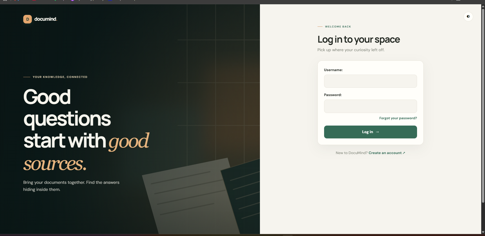
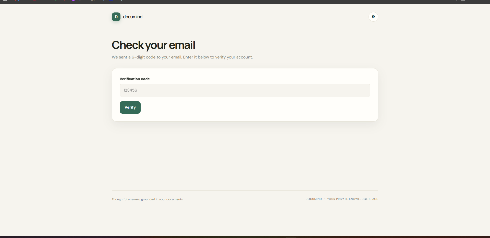
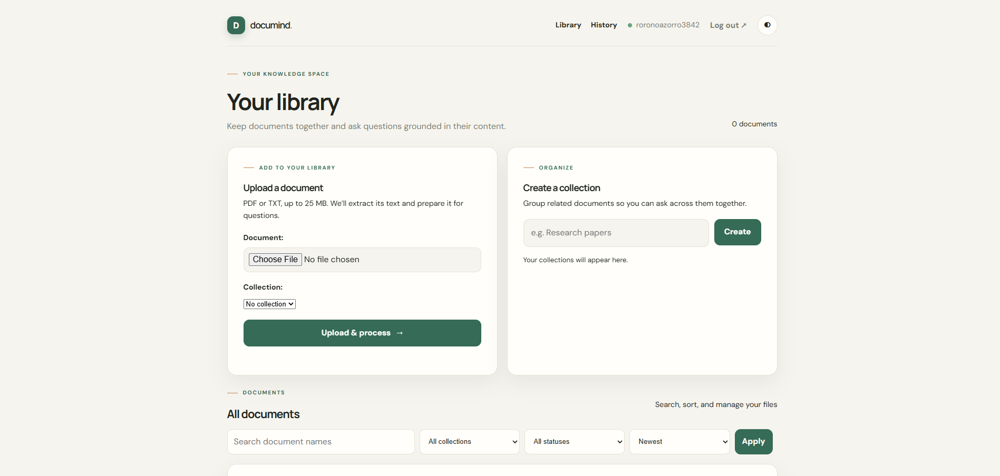
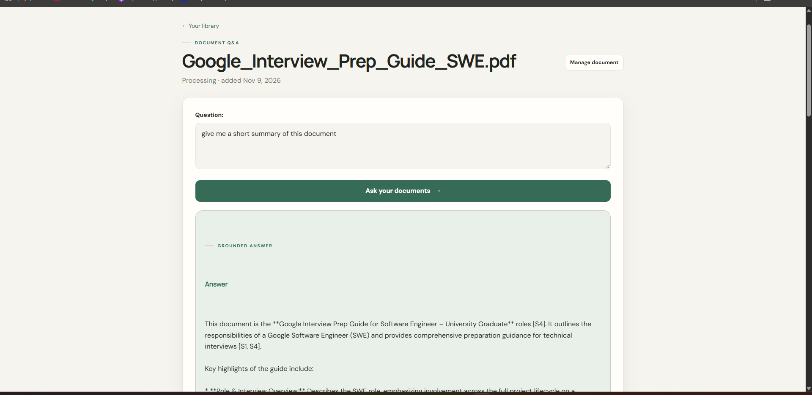
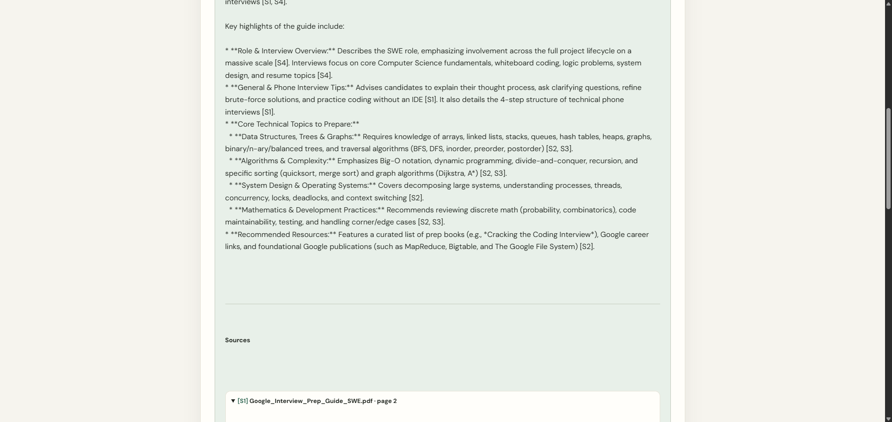
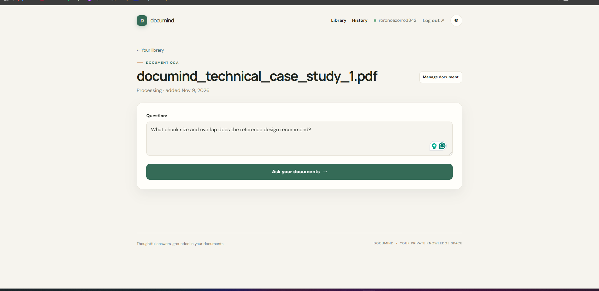
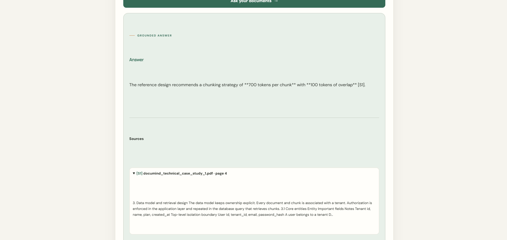
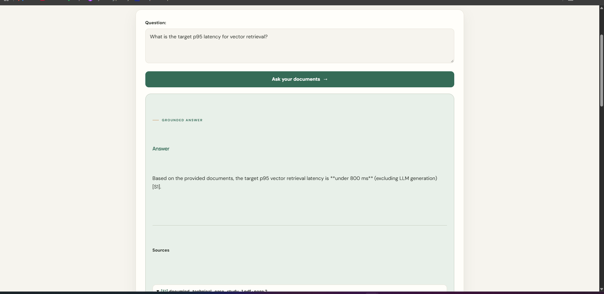
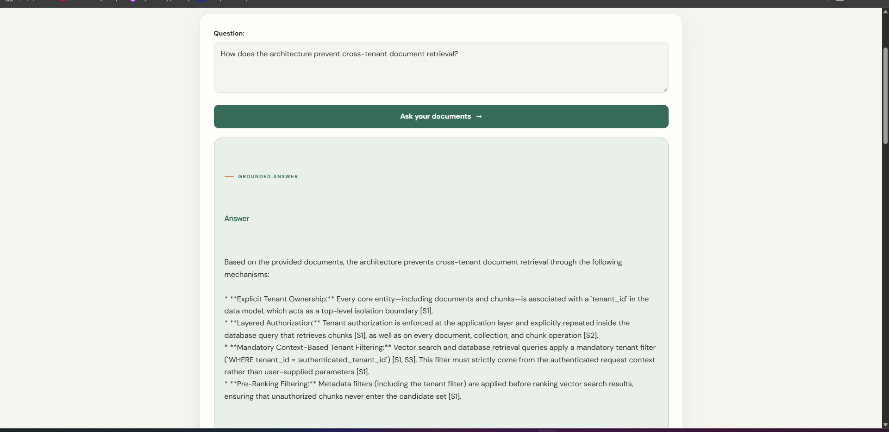
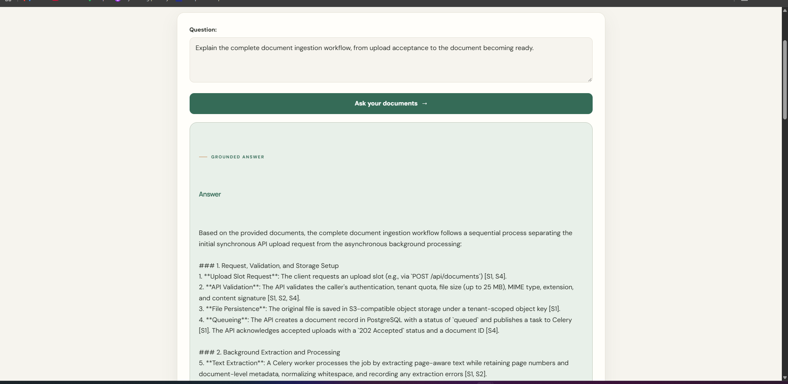

# 📄 DocuMind

> **Ask questions about your documents. Get grounded answers.**

[](https://www.python.org/)
[](https://www.djangoproject.com/)
[](https://www.postgresql.org/)
[](https://github.com/pgvector/pgvector)
[](https://docs.celeryq.dev/)
[](https://www.docker.com/)
[](https://aws.amazon.com/ec2/)

**Live demo:** https://doccumind.duckdns.org/

DocuMind is a full-stack Django application for asking natural-language questions about uploaded **PDF and TXT documents**.

It uses **Retrieval-Augmented Generation (RAG)** to retrieve relevant passages from a document or collection and provide only those excerpts to Google's Gemini model. Answers include source labels and, for PDF files, page references.

```text
Upload PDF/TXT (up to 25 MB)
      ↓
Extract PDF pages or TXT text
      ↓
Chunk, embed, and store in PostgreSQL + pgvector
      ↓
Ask about a document or ready collection
      ↓
Retrieve up to five matching chunks
      ↓
Generate a grounded answer with source references
```

---

## 📸 Screenshots

The gallery follows the user workflow from sign-in and verification through document upload, library organization, and grounded Q&A.

### 1. Sign in


### 2. Verify your email


### 3. Browse your library, upload documents, and organize collections


### 4. Ask for a document summary


### 5. Review an answer with source citations


### 6. Ask a question about a document


### 7. Inspect a chunking answer and its source


### 8. See a retrieval latency answer from an uploaded design document


### 9. Ask about tenant isolation in a source document


### 10. Ask about an ingestion workflow in a source document


> Screenshots 7–10 show answers grounded in example documents. Their chunk settings, latency targets, tenant model, and S3/HTTP 202 ingestion design belong to those documents. They are examples of cited Q&A, not DocuMind settings or benchmark results. The application behavior and configuration are documented below.

---

## ✨ Why DocuMind?

A conventional LLM application might send an entire document to the model for every question.

DocuMind retrieves only the most relevant information from the selected document or ready documents in a collection:

```text
Large document
      ↓
   Chunks
      ↓
Vector search
      ↓
Top 5 relevant chunks
      ↓
Gemini
      ↓
Grounded response
```

This keeps prompts focused, makes retrieval observable, and provides a practical foundation for scaling document-based Q&A.

---

## 🚀 Highlights

| Area | Implementation |
|---|---|
| **Web app** | Django 6.1 |
| **RAG** | Chunking → embeddings → pgvector retrieval → Gemini |
| **Embeddings** | `gemini-embedding-001`, 768 dimensions |
| **Answer generation** | `gemini-3.6-flash` |
| **Vector search** | PostgreSQL + `pgvector`, cosine distance |
| **Async processing** | Celery + Redis |
| **Authentication** | Django auth + email OTP |
| **Second factor** | Fresh email OTP on every login |
| **Frontend** | Django templates + HTMX |
| **API** | Django REST Framework + token authentication |
| **Document management** | 25 MB PDF/TXT uploads, collections, status, rename, retry, delete |
| **Answers** | Saved question history, source excerpts, PDF page citations, feedback |
| **Mobile** | Expo app with OTP login, secure token storage, upload, and cited Q&A |
| **Containers** | Docker / Docker Compose |
| **Production** | Gunicorn + nginx + Let's Encrypt |
| **Hosting** | AWS EC2 |

---

# 📚 Table of Contents

- [Screenshots](#-screenshots)
- [Features](#-features)
- [First-Time Walkthrough](#-first-time-walkthrough)
- [Architecture](#-architecture)
- [How the RAG Pipeline Works](#-how-the-rag-pipeline-works)
- [Authentication and Security](#-authentication-and-security)
- [Data Model](#-data-model)
- [Project Structure](#-project-structure)
- [Tech Stack](#-tech-stack)
- [Run Locally](#-run-locally)
- [REST API](#-rest-api)
- [Mobile app](#-mobile-app)
- [Testing](#-testing)
- [Docker](#-docker)
- [Production Deployment](#-production-deployment)
- [Configuration](#-configuration)
- [Troubleshooting](#-troubleshooting)
- [Current Limitations](#-current-limitations)
- [Roadmap](#-roadmap)
- [What This Project Demonstrates](#-what-this-project-demonstrates)
- [Author](#-author)

---

# ✨ Features

### 📚 Document library and collections

Upload PDF or TXT files up to 25 MB, organize them into private collections, and ask questions across the ready documents in a collection. Search by document name, filter by collection or processing status, and sort the library by upload date or name.

### 📄 Document Q&A with source citations

Ask questions about one ready document or a collection. Answers include source labels and excerpts. PDF sources include their original page number; TXT sources are identified by chunk position.

### ⚙️ Background ingestion and live status

Celery extracts text, splits it into overlapping chunks, creates embeddings, and stores them in PostgreSQL with pgvector. The library shows processing, ready, and failed states, supports retrying failed documents, and updates processing status without a full page refresh.

### 🧠 Grounded Gemini answers

DocuMind retrieves up to five relevant chunks and asks Gemini to answer from those excerpts, cite the supplied source labels, and say when the excerpts do not contain the answer.

### 🕘 Saved question history and feedback

Answers, questions, and retrieved sources are saved to the account. Revisit recent or full history and mark answers helpful or not helpful.

### 🔐 Email OTP authentication and password recovery

Signup requires email verification; each web or mobile login requires a fresh email OTP. Password reset is available through the website.

### 👤 User-scoped data access

Documents and collections belong to individual users. Web views, collection queries, and API endpoints scope access to the authenticated owner.

### 🔌 REST API and mobile app

The token-authenticated API supports OTP sign-in, document upload and listing, and document or collection Q&A. The Expo mobile app supports sign-in, upload, processing status, and cited answers.

### 🗑️ Document management

Rename documents, move them between your collections, retry failed processing, or delete them. Deleting a document removes its stored file and chunks; saved answers remain in question history.

### 🌙 Dark mode

The web interface supports a light/dark theme preference saved in the browser.

### 🐳 Containerized deployment

The project includes a Docker application image and Compose configuration for local PostgreSQL/pgvector and Redis. Production deployment also uses Gunicorn, nginx, HTTPS, Celery, and persistent media storage.

### 🧪 Automated tests

The test suite covers chunking, form validation, authentication, password reset, mobile OTP flows, library features, ownership, citations, feedback, Celery dispatch/retry, and Q&A behavior.

# 🏗️ Architecture

## High-level architecture

```text
                                      ┌────────────────────┐
                                      │      Browser       │
                                      └─────────┬──────────┘
                                                │ HTTPS
                                                ▼
                                      ┌────────────────────┐
                                      │   nginx container  │
                                      │ HTTP → HTTPS / TLS │
                                      └─────────┬──────────┘
                                                │
                                                ▼
                                      ┌────────────────────┐
                                      │ Django + Gunicorn  │
                                      │       web          │
                                      └───────┬────┬────────┘
                                              │    │
                               ┌──────────────┘    └──────────────┐
                               ▼                                  ▼
                     ┌──────────────────┐              ┌──────────────────┐
                     │ PostgreSQL       │              │      Redis       │
                     │ + pgvector       │              │  Celery broker   │
                     └────────┬─────────┘              └────────┬─────────┘
                              │                                   │
                              │                                   ▼
                              │                         ┌──────────────────┐
                              │                         │ Celery worker    │
                              │                         │ document ingest  │
                              │                         └────────┬─────────┘
                              │                                  │
                              └────────────────┬─────────────────┘
                                               │
                                               ▼
                                    ┌────────────────────┐
                                    │    Google Gemini   │
                                    │ embeddings + LLM   │
                                    └────────────────────┘
```

## Service responsibilities

| Service | Responsibility |
|---|---|
| **Django / Gunicorn** | Web requests, authentication, templates, document access, Q&A, REST API |
| **Celery worker** | Background document ingestion and embedding generation |
| **PostgreSQL + pgvector** | Users, documents, chunks, embeddings |
| **Redis** | Celery message broker |
| **nginx** | Reverse proxy, HTTP→HTTPS redirect, TLS termination |
| **Gemini API** | Embeddings and answer generation |

---

# 🧠 How the RAG Pipeline Works

## 1. Upload and queue processing

The web form and API accept PDF/TXT files up to 25 MB. They validate the extension and, for the web upload, associate the file with one of the current user's collections when selected. DocuMind creates a document with `processing` status and queues a Celery task through Redis. If queuing fails, the document is marked `failed`.

## 2. Extract text while preserving PDF pages

`qa/extraction.py` extracts PDF text page by page with `pypdf`. TXT files are decoded as UTF-8. Unsupported extensions are rejected, and a document with no readable text fails processing. The page number is retained for each PDF chunk so answers can point back to the source page.

## 3. Split each page into overlapping chunks

`qa/chunking.py` splits text on whitespace into **800-word chunks with a 100-word overlap**. PDF pages are chunked separately, so a chunk does not span two PDF pages. TXT files have no page numbers and are chunked as one text stream.

## 4. Embed and store chunks

Each chunk is embedded with `gemini-embedding-001` at 768 dimensions. DocuMind stores the text, vector, order, and optional PDF page number in PostgreSQL using pgvector.

## 5. Retrieve context for a question

For a document question, retrieval searches that document. For a collection question, it searches the ready documents in that collection. DocuMind embeds the question, ranks chunks by cosine distance, and selects up to five nearest chunks.

## 6. Generate and save a cited answer

DocuMind labels the retrieved excerpts (`[S1]`, `[S2]`, and so on) and sends them with the question to `gemini-3.6-flash`. The prompt treats excerpts as untrusted source material, asks the model to use only those excerpts, cite the provided labels, and report when the answer is not present. The answer, question, and source details are saved to the user's history and shown with source excerpts and PDF page numbers where available.

## End-to-end workflow

```text
PDF/TXT upload (extension and 25 MB limit checked)
        ↓
Create user-owned Document(status="processing")
        ↓
Queue Celery task through Redis
        ↓
Extract PDF pages or decode TXT
        ↓
Split into 800-word chunks with 100-word overlap
        ↓
Create 768-dimensional Gemini embeddings
        ↓
Store chunks and vectors in PostgreSQL + pgvector
        ↓
Mark ready (or failed with a retry option)
        ↓
Embed question and retrieve up to 5 chunks
        ↓
Ask Gemini to answer from labeled source excerpts
        ↓
Save answer, source references, and question history
```

Uploaded files use Django file-system storage under `MEDIA_ROOT`; the application does not use S3 as its live file store. Screenshots 7–10 show answers about example architecture documents, not DocuMind settings or benchmark results. See the screenshot note and RAG configuration below for the distinctions.

# 🔐 Authentication and Security

## Signup

```text
Username + email + password
          ↓
User created as inactive
          ↓
6-digit signup OTP sent by email
          ↓
OTP verification
          ↓
Account activated
```

## Login

```text
Username + password
          ↓
Django authentication
          ↓
Fresh 6-digit OTP
          ↓
Email
          ↓
OTP verification
          ↓
Authenticated session
```

OTP codes expire after **10 minutes** and cannot be reused after successful verification.
Mobile OTP verification locks a code after five incorrect attempts.

---

## Document ownership

Every document belongs to a user:

```text
User
 └── Document
      └── Chunk
```

The application enforces ownership when retrieving documents.

A simplified access pattern is:

```python
Document.objects.filter(
    id=document_id,
    owner=request.user,
)
```

This is enforced in both the web views and API. Collections are also owner-scoped. This is user-level isolation; the application does not implement a separate tenant model.

A user attempting to access another user's document receives a `404`, making that document effectively invisible from their account.

---

## Production security

When running with `DEBUG=False`, the application enables security-related Django settings including:

- Secure session cookies
- Secure CSRF cookies
- HTTPS redirects
- HSTS
- `X-Content-Type-Options: nosniff`
- `X-Frame-Options: DENY`
- Forwarded HTTPS handling through nginx

---

# 🗃️ Data Model

### Collection

A named group of documents owned by one user. Collection names are unique per user.

### Document

| Field | Purpose |
|---|---|
| `owner` | User who owns the document |
| `file` / `display_name` | Stored PDF/TXT and optional library name |
| `collection` | Optional collection assignment |
| `uploaded_at` | Upload timestamp |
| `status` | `processing`, `ready`, or `failed` |
| `processing_error` | User-facing processing failure detail, when available |

### Chunk

| Field | Purpose |
|---|---|
| `document` | Parent document |
| `text` | Extracted chunk content |
| `embedding` | 768-dimensional vector |
| `order` | Chunk sequence within the document |
| `page_number` | Original PDF page, or empty for TXT |

### AnswerRecord and AnswerFeedback

`AnswerRecord` stores the owner, question, answer, document or collection context, retrieved source excerpts, and creation time. `AnswerFeedback` stores a user's helpful/not-helpful rating and optional comment for an answer.

### OTPCode

Signup and login verification codes include their channel, purpose, expiration, used state, and attempt count. Codes expire after 10 minutes; the mobile verification endpoint locks a code after five incorrect attempts.

---

# 📁 Project Structure

```text
documind/
├── Knowly/                 # Django settings, URLs, WSGI, and Celery app
├── qa/                     # Web app, API, RAG pipeline, templates, and tests
│   ├── extraction.py
│   ├── chunking.py
│   ├── embeddings.py
│   ├── retrieval.py
│   ├── services.py          # Retrieval, citations, and answer persistence
│   ├── ingestion.py
│   ├── tasks.py
│   ├── models.py
│   └── tests/
├── mobile/                 # Expo / React Native client
├── scripts/                # Database and media backup scripts
├── screenshots/             # README product screenshots
├── docker-compose.yml       # Local PostgreSQL/pgvector and Redis
├── docker-compose.ops.yml   # Production operations override
├── Dockerfile
├── manage.py
└── requirements.txt
```

## Core modules

| File | Responsibility |
|---|---|
| `qa/extraction.py` | Page-aware PDF and TXT text extraction |
| `qa/chunking.py` | 800-word chunks with 100-word overlap |
| `qa/embeddings.py` | Gemini text embeddings |
| `qa/retrieval.py` | pgvector cosine-distance search |
| `qa/services.py` | Source labeling, answer generation, and history persistence |
| `qa/llm.py` | Grounded Gemini prompt and answer generation |
| `qa/tasks.py` | Celery ingestion jobs and processing status |
| `qa/views.py` | Library, collections, authentication, history, and web Q&A |
| `qa/api_views.py` | OTP-authenticated mobile and document Q&A API |
| `qa/models.py` | Documents, collections, chunks, answer history, feedback, and OTPs |

# 🛠️ Tech Stack

| Layer | Technology |
|---|---|
| Language | Python 3.12+ |
| Framework | Django 6.1 |
| Database | PostgreSQL 16 |
| Vector extension | `pgvector` |
| Vector similarity | Cosine distance |
| Async jobs | Celery |
| Broker | Redis |
| Embeddings | `gemini-embedding-001` |
| LLM | `gemini-3.6-flash` |
| REST API | Django REST Framework |
| API auth | DRF TokenAuthentication |
| Frontend | Django Templates + HTMX |
| CSS | Custom CSS |
| PDF parsing | `pypdf` |
| Application server | Gunicorn |
| Reverse proxy | nginx |
| Containers | Docker / Docker Compose |
| TLS | Let's Encrypt / Certbot |
| Hosting | AWS EC2 |
| DNS | DuckDNS |

---

# 🚀 Run Locally

## Prerequisites

Install:

- Python **3.12+**
- Git
- Docker + Docker Compose
- Google Gemini API key
- SMTP credentials for email OTP delivery

---

## 1. Clone

```bash
git clone https://github.com/rahulprojectcoding-commits/documind.git
cd documind
```

---

## 2. Create a virtual environment

### Linux / macOS

```bash
python3 -m venv venv
source venv/bin/activate
```

### Windows

```powershell
python -m venv venv
venv\Scripts\activate
```

---

## 3. Install dependencies

```bash
pip install -r requirements.txt
```

---

## 4. Start PostgreSQL + pgvector and Redis

```bash
docker compose up -d
```

Check:

```bash
docker compose ps
```

The development Compose setup provides PostgreSQL/pgvector and Redis.

---

## 5. Configure application settings

Create a `.env` file in the repository root. The repository does not include a ready-to-copy root `.env.example`; the following values show the local settings to configure:

```dotenv
DJANGO_SECRET_KEY=replace-with-a-random-secret
DJANGO_DEBUG=True
DJANGO_ALLOWED_HOSTS=127.0.0.1,localhost
GEMINI_API_KEY=your-gemini-api-key
POSTGRES_DB=documind
POSTGRES_USER=documind
POSTGRES_PASSWORD=documind
POSTGRES_HOST=localhost
POSTGRES_PORT=5432
CELERY_BROKER_URL=redis://localhost:6379/0
EMAIL_HOST_USER=your-gmail-address
EMAIL_HOST_PASSWORD=your-google-app-password
```

The local Compose file uses the shown PostgreSQL defaults. Keep `.env` private; it is ignored by Git. DocuMind uses Gmail SMTP for signup/login OTP and password-reset email. For Gmail accounts with 2-Step Verification, use a Google App Password.

---

## 6. Run migrations

```bash
python manage.py migrate
```

This initializes the Django database and pgvector extension used by the project.

---

## 7. Optional: create an admin user

```bash
python manage.py createsuperuser
```

Then:

```text
http://127.0.0.1:8000/admin/
```

---

## 8. Start Django

Terminal 1:

```bash
python manage.py runserver
```

Open:

```text
http://127.0.0.1:8000/
```

---

## 9. Start Celery

Terminal 2:

```bash
celery -A Knowly worker --loglevel=info
```

### Windows

```bash
celery -A Knowly worker --loglevel=info --pool=solo
```

Keep the worker running while uploading documents.

---

# 🧪 First-Time Walkthrough

After starting Django and Celery:

```text
1. Open the application
2. Create an account and verify the signup email code
3. Sign in and verify the fresh email code
4. Upload a PDF or TXT file (up to 25 MB), optionally adding it to a collection
5. Watch the library status change from Processing to Ready
6. Open the document or collection and ask a question
7. Review the grounded answer and expand its cited source excerpts
8. Revisit the answer in History and leave helpful/not-helpful feedback
```

---

# 🔌 REST API

The API supports Django REST Framework token authentication for mobile and other API clients. Session authentication is also enabled for browser-based requests.

For token-authenticated API requests, send:

```http
Authorization: Token <your_token>
```

## Mobile sign-in (OTP required)

POST /api/auth/login/ accepts a JSON username and password. If the credentials
are valid, DocuMind emails a six-digit code. Exchange it at
POST /api/auth/verify-otp/ with the same username and the code to receive an
API token.

Store the token in the device secure store and send it in the
Authorization: Token YOUR_TOKEN header. Login and OTP verification are
rate-limited. The old password-only /api/token/ route is removed so it cannot
bypass email verification.

GET /api/auth/me/ returns basic account details. POST /api/auth/logout/ revokes
the current token.

---

## List documents

```http
GET /api/documents/
```

```bash
curl http://127.0.0.1:8000/api/documents/ \
  -H "Authorization: Token YOUR_TOKEN"
```

Only documents owned by the authenticated user are returned.

---

## Upload a document

```http
POST /api/documents/
```

```bash
curl -X POST http://127.0.0.1:8000/api/documents/ \
  -H "Authorization: Token YOUR_TOKEN" \
  -F "file=@example.pdf"
```

The document is created and processing is queued asynchronously.

---

## Get one document

```http
GET /api/documents/<id>/
```

```bash
curl http://127.0.0.1:8000/api/documents/5/ \
  -H "Authorization: Token YOUR_TOKEN"
```

---

## Ask a question

```http
POST /api/documents/<id>/ask/
```

```bash
curl -X POST http://127.0.0.1:8000/api/documents/5/ask/ \
  -H "Authorization: Token YOUR_TOKEN" \
  -H "Content-Type: application/json" \
  -d '{"question":"What is this document about?"}'
```

Example response:

```json
{
  "question": "What is this document about?",
  "answer": "...",
  "sources": [{"label":"S1","document_title":"example.pdf","page_number":1,"text":"..."}],
  "answer_id": 42
}
```

For collection Q&A, use `POST /api/collections/<id>/ask/` with the same JSON question body. Both Q&A endpoints return the answer, source details, and saved `answer_id`. The collection endpoint searches only ready documents owned by the authenticated user.

If the document is still being processed:

```http
409 Conflict
```

```json
{
  "error": "Document is not ready yet"
}
```

---

# 📱 Mobile app

The mobile/ folder contains a React Native app built with Expo SDK 57. It
supports OTP sign-in, secure token storage, PDF/TXT upload, document processing
status, and document Q&A with source/page citations.

From the mobile/ directory, run npm install and then npx expo start.

The app defaults to the production HTTPS site. To use a local API, create
mobile/.env from .env.example and set EXPO_PUBLIC_API_BASE_URL to a URL
reachable by your phone (for example, your computer LAN IP, not localhost).
Existing website accounts can sign in; account creation and password reset
remain on the website.

### Build an installable Android APK

Install Node.js 22.13 or newer and npm on your computer, then from mobile/ run:

    npm install
    npx eas-cli@latest login
    npx eas-cli@latest build:configure
    npx eas-cli@latest build --platform android --profile preview

The first EAS setup links the app to your Expo account. When the cloud build
finishes, open the build page on your Android phone and download/install the
APK. Android may ask you to allow installing apps from that browser. The
preview profile is for direct device installation; the production profile
builds an Android App Bundle for Google Play.

# 🧪 Testing

Run the full test suite with:

```bash
python manage.py test
```

The test suite covers:

- Model behavior
- Default document status
- Chunk ordering
- Chunk splitting and overlap
- Form validation
- Authentication enforcement
- Document ownership
- Cross-user isolation
- Celery task dispatch
- Question answering
- HTMX-aware responses
- Collections, cross-document collection retrieval, citations, and feedback
- Mobile OTP authentication, token revocation, and password reset

External Gemini and Celery operations are mocked where appropriate, so the suite does not depend on real AI API calls.

---

# 🐳 Docker

The project includes a Dockerfile for the application image.

The image:

1. Uses `python:3.12-slim`
2. Installs required system packages
3. Installs Python dependencies
4. Copies the project
5. Collects static files
6. Runs Gunicorn on port `8000`

The production web service runs:

```bash
gunicorn Knowly.wsgi:application --bind 0.0.0.0:8000 --workers 3
```

---

# 🌐 Production Deployment

The live service runs on AWS EC2 with Docker Compose. Its deployment topology includes nginx, Django/Gunicorn, a Celery worker, PostgreSQL with pgvector, Redis, and the Gemini API. The production deployment uses HTTPS and persistent media storage.

The repository tracks `docker-compose.yml` for local PostgreSQL/pgvector and Redis, plus `docker-compose.ops.yml` for operational settings such as persistent media, health checks, and bounded container logs. The production `docker-compose.prod.yml` and `nginx.conf` are maintained on the EC2 host and are not included in this repository. This describes the deployed topology; it does not imply that the host-only production files can be launched from a fresh clone.

# ⚙️ Production Deployment Flow

The deployed host-specific flow is:

```text
Prepare production environment and secrets on EC2
      ↓
Build/pull the application image
      ↓
Start the host-managed production Compose stack
      ↓
Run Django migrations
      ↓
Verify database health, nginx, and HTTPS
      ↓
Verify the Celery worker and Redis
      ↓
Upload a PDF/TXT document and wait for Ready
      ↓
Ask a question and inspect its source excerpts
```

The production Compose file and nginx configuration are host-managed rather than tracked in this repository. The tracked `docker-compose.ops.yml` is an override for the server-managed production Compose file; consult the persistent upload and operations notes below before applying it to an existing deployment.

# 📌 Useful Commands

### Start local infrastructure

```bash
docker compose up -d
```

### Stop local infrastructure

```bash
docker compose down
```

### Run migrations

```bash
python manage.py migrate
```

### Run tests

```bash
python manage.py test
```

### Run Django

```bash
python manage.py runserver
```

### Run Celery

```bash
celery -A Knowly worker --loglevel=info
```

### Create admin user

```bash
python manage.py createsuperuser
```

### Collect static files

```bash
python manage.py collectstatic
```

---

# 🧪 Recommended RAG Evaluation

A useful test document should contain predictable information such as:

- Company details
- Dates
- Pricing
- Policies
- Limits
- Support SLAs
- Security rules

Then test several question types.

### Direct retrieval

```text
What is the company called?
```

### Numerical retrieval

```text
What is the API request limit?
```

### Conditional retrieval

```text
What happens after five failed login attempts?
```

### Multi-part retrieval

```text
What are the plan price, API limit, and support SLA?
```

### Negative / hallucination test

```text
Who is the CEO?
```

For information that is genuinely absent from the document, the desired behavior is an explicit acknowledgement that it is not available rather than an invented answer.

---

# ⚠️ Troubleshooting

## Documents remain in `processing`

Check that:

```text
Redis is running
Celery worker is running
Gemini API access is working
PostgreSQL is reachable
```

For Docker:

```bash
docker compose ps
```

---

## Gemini requests fail

Check the configured:

```text
GEMINI_API_KEY
```

and verify access to the models used by the project.

---

## PostgreSQL connection fails

Check the database container:

```bash
docker compose ps
```

and verify:

```text
POSTGRES_HOST
POSTGRES_PORT
POSTGRES_DB
POSTGRES_USER
POSTGRES_PASSWORD
```

---

## Redis connection fails

Verify Redis is running and that the Celery broker URL points to:

```text
redis://localhost:6379/0
```

for local host-based execution.

---

## OTP email does not arrive

Check:

- SMTP credentials
- Gmail App Password
- Spam/junk folder
- `EMAIL_HOST_USER`
- `EMAIL_HOST_PASSWORD`

OTP codes expire after **10 minutes**.

---

## API returns `409 Conflict`

For:

```http
POST /api/documents/<id>/ask/
```

a `409` response means the document has not reached:

```text
status = "ready"
```

Wait for background processing to finish and retry.

---

# 📏 RAG Configuration

These values come from the current implementation in `qa/chunking.py`, `qa/embeddings.py`, and `qa/retrieval.py`:

| Parameter | Implemented value |
|---|---|
| Chunk size | 800 whitespace-separated words |
| Chunk overlap | 100 words |
| PDF chunking | Separately within each extracted page; page number retained |
| TXT chunking | Single unpaginated text stream |
| Embedding model | `gemini-embedding-001` |
| Embedding dimensions | 768 |
| Retrieval | Cosine distance, up to 5 chunks |
| Answer model | `gemini-3.6-flash` |
| OTP lifetime | 10 minutes |

One screenshot quotes an example document recommending 700 tokens per chunk and 100 tokens of overlap. That is the recommendation in the document being queried; DocuMind's code uses 800 words and 100 words. The screenshot's under-800-ms p95 figure is also a target stated in a source document. DocuMind does not currently report a retrieval latency benchmark.

---

# 🧭 Current Limitations

The current implementation focuses on straightforward vector-based document Q&A. Current limitations and possible next steps include:

- PDF text extraction does not preserve complex table or visual layout structure.
- Only PDF and TXT uploads are supported.
- Retrieval uses cosine similarity over vectors without hybrid keyword search, reranking, or query rewriting.
- Each question is answered independently; prior questions and answers are saved in history but are not passed as conversational context to the next answer.
- File uploads use Django file-system storage under `MEDIA_ROOT`; the application does not use S3 as its live file store. Separate backup scripts can send database and media backups to S3.
- There are no usage tiers or billing controls.
- SMS OTP is not implemented; OTP email delivery uses Gmail SMTP configuration.
- The repository would benefit from broader automated RAG evaluation datasets and operational metrics.

Source excerpts, PDF page references, saved question history, and answer feedback are implemented features.

---

# 🗺️ Roadmap

```text
[x] PDF/TXT ingestion with 25 MB upload validation
[x] Page-aware PDF extraction and chunking
[x] Gemini embeddings and pgvector retrieval
[x] Grounded answers with source excerpts and PDF page references
[x] Background processing, status updates, and retry for failed documents
[x] Email OTP signup and login
[x] User-scoped document and collection access
[x] Collections and cross-document Q&A
[x] Saved question history and answer feedback
[x] REST API and Expo mobile client
[x] Docker deployment, HTTPS, and persistent media operations
[x] Database and media backup scripts with S3 targets

[ ] Additional document formats and improved table extraction
[ ] Hybrid retrieval, reranking, and query rewriting
[ ] Multi-turn conversational context
[ ] S3-backed live document storage
[ ] Usage tiers / billing
[ ] SMS OTP
[ ] Expanded RAG evaluation and operational metrics
```

# 🎯 What This Project Demonstrates

DocuMind combines several areas into one end-to-end application.

### Backend engineering

- Django
- ORM
- Authentication
- File uploads
- Forms
- REST APIs
- Authorization
- Security

### Generative AI

- Embeddings
- LLM integration
- Prompt design
- Retrieval-Augmented Generation
- Context construction
- Hallucination mitigation

### Data / search

- PDF text extraction
- Chunking
- Vector storage
- Similarity search

### Asynchronous systems

- Celery
- Redis
- Background jobs

### DevOps

- Docker
- Docker Compose
- Gunicorn
- nginx
- Let's Encrypt
- AWS EC2

---

# 👨‍💻 Author

**Rahul Rathod**

Python Developer · Django · RAG · Generative AI · AWS

**Live application:** https://doccumind.duckdns.org/

---

## 📚 Collections, citations, and operations

The library supports collections for grouping PDFs and text files. Ask a question
from a collection to search across its ready documents. Answers include source
labels and excerpts; PDF excerpts keep their original page number. Question
history and helpful/not-helpful feedback are saved to the account.

Uploads accept PDF and TXT files up to 25 MB. Failed processing shows a
user-facing reason where available and can be retried from the library. The
/health/ endpoint checks the database connection for a container or uptime
probe.

### Persistent document uploads

The production Compose file stays on EC2 as an untracked server configuration.
The tracked docker-compose.ops.yml override adds a shared media volume, a Django
health check, and bounded Docker logs. Before enabling that volume on an
existing deployment, copy current uploads out of the old container:

    mkdir -p ~/documind-media-staging
    docker compose -f docker-compose.prod.yml cp web:/app/media/. ~/documind-media-staging/

Apply both Compose files to create and attach the new volume:

       docker compose -f docker-compose.prod.yml -f docker-compose.ops.yml up -d

Then copy the saved files into the volume mounted at /app/media. The worker
shares that volume. Keep the temporary copy until existing documents open:

    docker compose -f docker-compose.prod.yml -f docker-compose.ops.yml cp ~/documind-media-staging/. web:/app/media/

After initial migration, rebuild/deploy with the same two Compose files.

### Nginx Docker DNS refresh

Nginx can retain a container IP after Compose replaces the web container. In
the proxy location, use Docker's embedded DNS resolver so the service name is
looked up again:

    resolver 127.0.0.11 valid=30s ipv6=off;
    set $web_upstream web:8000;
    proxy_pass http://$web_upstream;

Keep the existing proxy headers, TLS, and request-size settings around these
lines. Validate the Nginx config and reload Nginx after changing it.

### Container log rotation

Add this to each long-running service in production Compose (web, worker, nginx,
db, and redis) to cap each JSON log at about 30 MB:

    logging:
      driver: json-file
      options:
        max-size: "10m"
        max-file: "3"

The application writes processing failures to container logs. Set LOG_LEVEL to
INFO by default or DEBUG temporarily while troubleshooting.

### PostgreSQL backups to S3

The scripts scripts/backup_database.sh and scripts/backup_media.sh stream
compressed database and uploaded-file backups directly to S3, so backups do not
accumulate on the EC2 root disk. Configure an EC2 instance role with permission
to upload to private S3 buckets, install the AWS CLI, and set the corresponding
destination variables. Run:

    BACKUP_S3_URI=s3://your-private-bucket/documind-backups bash scripts/backup_database.sh
    MEDIA_BACKUP_S3_URI=s3://your-private-bucket/documind-media bash scripts/backup_media.sh

Schedule both commands with cron after successful manual runs. Enable S3
versioning and a lifecycle retention policy on the buckets, and periodically
test restoring a database backup and a media archive.

## 📜 License

Add the repository license here when one is selected, for example:

```text
MIT License
```
